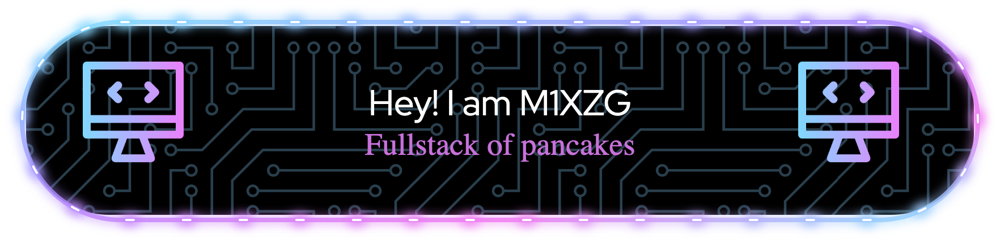
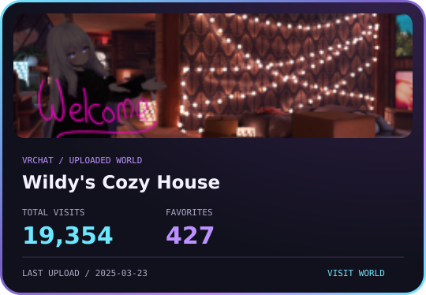
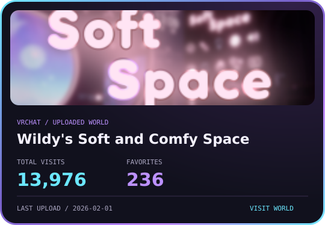
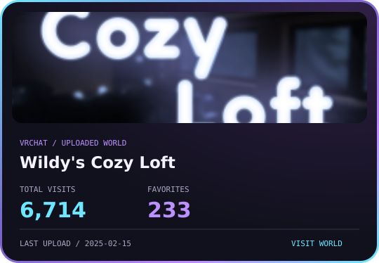
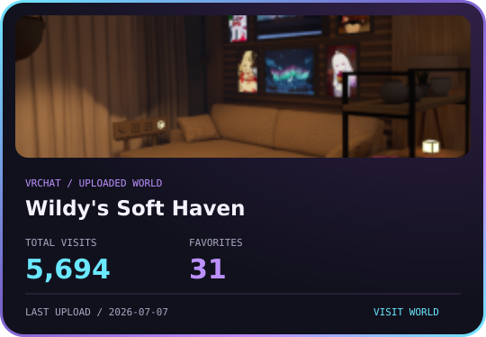
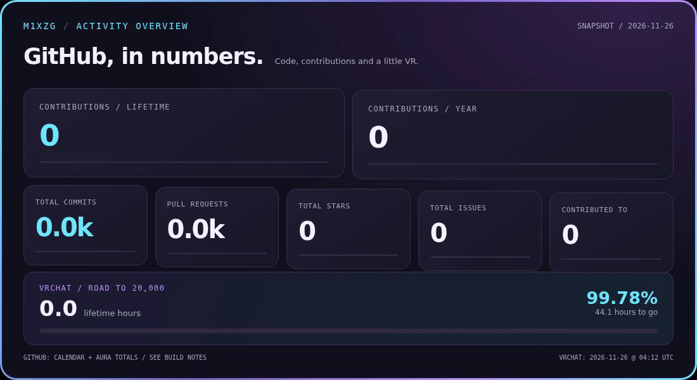
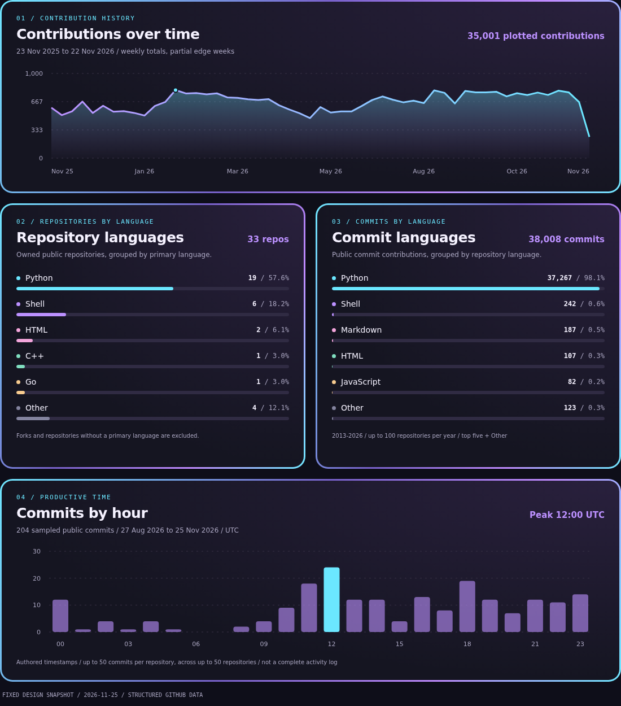
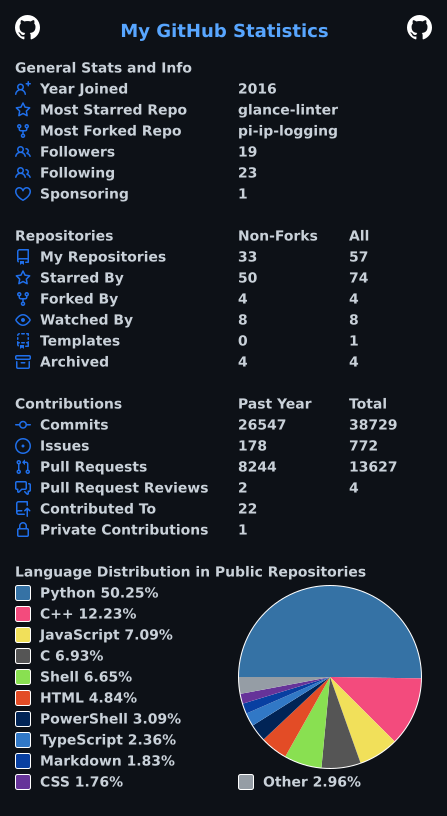

  

Banner generated with <a href="https://leviarista.github.io/github-profile-header-generator/">GitHub Profile Header Generator</a>.

<h1 align="center">Hey, thanks for sliding into my profile 👋</h1>

  
  
  
  

---

## 👀 At a Glance

  

    
    
    
<!-- start vrchatBadgeHERE -->
<!-- end vrchatBadgeHERE -->
    
  

---

## 📑 Table of Contents

- [👀 At a Glance](#-at-a-glance)
- [📑 Table of Contents](#-table-of-contents)
- [🧑‍💻 About Me](#-about-me)
- [🌐 Socials](#-socials)
- [🥽 My VRChat Info](#-my-vrchat-info)
  - [🥽 My current hours](#-my-current-hours)
  - [🥽🤖 AFK Instance Bot hours](#-afk-instance-bot-hours)
  - [🥽🌐 Some of the worlds I've uploaded](#-some-of-the-worlds-ive-uploaded)
- [🚦 Workflow Status](#-workflow-status)
- [📊 Stats](#-stats)
- [🌐🌍 WiGLE Stats](#-wigle-stats)
- [📡 Broadband Monitor](#-broadband-monitor)

---

## 🧑‍💻 About Me

I love to drink coffee :coffee:, too much coffee :coffee: :coffee: :coffee:. I wish [PSL](https://www.starbucks.com/menu/product/418/hot) was available year-round.

Mostly I like to tinker with bash/zsh scripts and home automation. I love <b>Raspberry Pi's</b> and use quite a few of them for various jobs around the house. Most recently I'm using a Pi 4 8GB with <b>Docker</b> to run a couple of custom containers (which I might release) as well as <b>Plex</b>. Also running my own <a href="https://github.com/M1XZG/Raspberry-pi-kiosk-config">kiosk</a> configuration and <a href="https://sdr-enthusiasts.gitbook.io/ads-b/">ADS-B Reception, Decoding & Sharing with Docker</a>.

Some of my fav projects and organisations on GitHub that I'm part of, support or just use are:

- [Discord bot for fun](https://github.com/M1XZG/discord-bot-for-fun) - Now with fishing and even a contest mode for fishing
- [Swindon Makerspace](https://github.com/swindonmakers)
- [OhMyZSH](https://github.com/ohmyzsh/ohmyzsh)
- [ZSH History](https://github.com/rchakra3/zsh_history)
- [TTS Voice Wizard](https://github.com/VRCWizard/TTS-Voice-Wizard) (I'm using this for [VRChat](https://vrchat.com/))
- ... more to come, I just can't think of them off hand

Thanks for stopping by! You can find me on various [social media platforms](https://www.uk-experience.com/social-media-site-links/) (that's also a link to my blog, I really need to get more active on there).

> 💡 *Psst! If you don't know what icons are available, check out this [emoji cheat sheet](https://github.com/ikatyang/emoji-cheat-sheet/blob/master/README.md). If you want some of the nifty badges below, check out [shields.io](https://shields.io/).*

---

## 🌐 Socials

  
  
  
  
  

---

## 🥽 My VRChat Info

 
Click to see my past milestones

| Date | Hours |  | Date | Hours |
| :--- | :--- | :---: | :--- | :--- |
| 2022-06-01 | Started |  | 2026-04-03 | 15000 hrs |
| 2023-01-01 | ~40 hrs |  | 2026-05-24 | 16000 hrs |
| 2024-06-02 | 3000 hrs |  | 2026-07-07 | 17000 hrs |
| 2024-07-31 | 4000 hrs |  | 2026-08-24 | 18000 hrs |
| 2024-09-17 | 5000 hrs |  | 2026-10-07 | 19000 hrs |
| 2024-11-07 | 6000 hrs |  |  |  |
| 2024-12-22 | 6900 hrs |  |  |  |
| 2024-12-29 | 7000 hrs |  |  |  |
| 2025-03-18 | 8000 hrs |  |  |  |
| 2025-06-13 | 9000 hrs |  |  |  |
| 2025-08-17 | 10000 hrs |  |  |  |
| 2025-10-08 | 11000 hrs |  |  |  |
| 2025-11-25 | 12000 hrs |  |  |  |
| 2026-01-07 | 13000 hrs |  |  |  |
| 2026-02-21 | 14000 hrs |  |  |  |

### 🥽 My current hours

<!-- start myhoursHERE -->
<!-- end myhoursHERE -->

### 🥽🤖 AFK Instance Bot hours

<!-- start afkhoursHERE -->
<!-- end afkhoursHERE -->

The above is reported by the Steam API which is potentially 1-2 hours behind what the game client reports.

### 🥽🌐 Some of the worlds I've uploaded

<!-- themed-section-preview -->

<table width="100%">
  <tr>
    <td width="50%"></td>
    <td width="50%"></td>
  </tr>
  <tr>
    <td width="50%"></td>
    <td width="50%"></td>
  </tr>
</table>

World data snapshot: 2026-11-25 06:19 UTC. Refreshed by the profile workflow. <a href="https://raw.githubusercontent.com/M1XZG/M1XZG/main/assets/profile-sections/snapshot.json">Source data</a>.

Live badges and links

<table>
  <tr>
    <td valign="top">
      <h4 id="-wildys-cozy-house">🥽🏠 <a href="https://vrchat.com/home/world/wrld_5931e6c9-1b23-4852-9c73-ee0bf273e224">Wildy’s Cozy House</a></h4>
       
       
      
    </td>
    <td valign="top">
      <h4 id="-wildys-soft-and-comfy-space">🥽🏠 <a href="https://vrchat.com/home/world/wrld_9f2d7f50-b918-4bab-9452-4b1c9a15ed69">Wildy’s Soft and Comfy Space</a></h4>
       
       
      
    </td>
  </tr>
  <tr>
    <td valign="top">
      <h4 id="-wildys-cozy-loft">🥽🏠 <a href="https://vrchat.com/home/world/wrld_2bdb0569-b7d2-4d0c-8214-7adb3224a5fc">Wildy’s Cozy Loft</a></h4>
       
       
      
    </td>
  <td valign="top">
    <h4 id="-wildys-soft-haven">🥽🏠 <a href="https://vrchat.com/home/world/wrld_dde3e2a3-cde3-4d4e-8a51-99d49f3d6f50">Wildy’s Soft Haven</a></h4>
      
      
     
   </td>
  </tr>
</table>

---

## 🚦 Workflow Status

<table width="100%">
  <thead><tr><th align="left">Workflow</th><th>Status</th></tr></thead>
  <tbody>
    <tr>
      <td><a href="https://github.com/M1XZG/M1XZG/actions/workflows/update-vrchat-hours-unified.yaml">My VRChat Hours Update</a></td>
      <td align="center"></td>
    </tr>
    <tr>
      <td><a href="https://github.com/M1XZG/uptime/actions/workflows/uptime.yml">M1XZG Uptime Monitor</a></td>
      <td align="center"></td>
    </tr>
    <tr>
      <td><a href="https://github.com/M1XZG/M1XZG/actions/workflows/profile-summary-cards.yml">M1XZG Profile Card Creator</a></td>
      <td align="center"></td>
    </tr>
    <tr>
      <td><a href="https://github.com/M1XZG/shared-game-images/actions/workflows/pages.yml">Shared Game Images - GitHub Pages</a></td>
      <td align="center"></td>
    </tr>
    <tr>
      <td><a href="https://github.com/M1XZG/shared-game-images/actions/workflows/replace_posters.yml">Replace Posters Daily</a></td>
      <td align="center"></td>
    </tr>
  </tbody>
</table>

Status badges update independently of this README. Open a workflow for its latest runs.

---

## 📊 Stats

  <picture>
    <source media="(prefers-reduced-motion: reduce)" srcset="https://raw.githubusercontent.com/M1XZG/M1XZG/main/templates/remotion-preview/overview.png?v=23bf7b94c033dd1a" />
    
  </picture>

One short animation, then a still frame. <a href="https://raw.githubusercontent.com/M1XZG/M1XZG/main/templates/remotion-preview/overview.png?v=23bf7b94c033dd1a">View the still image</a>.

  

Figures and build notes

The hourly [profile workflow](https://github.com/M1XZG/M1XZG/actions/workflows/update-vrchat-hours-unified.yaml) refreshes these images alongside the VRChat hours. The detailed charts use [structured GitHub data](https://raw.githubusercontent.com/M1XZG/M1XZG/main/templates/remotion-preview/chart-data.json), not estimates from the old chart images. Both contribution totals use calendar data; the other GitHub headline totals still come from the existing Aura cards and keep their original rounding.

Contributions / Year means the trailing year, not the current calendar year. That card and the contribution chart use the sum of the calendar's dated entries (35,001). GitHub returned 35,001 separately as its calendar summary; both values are preserved in the data file rather than forcing them to agree.

Contributions / Lifetime sums dated entries across every GitHub contribution year, 2013-2026, without counting adjacent-year calendar padding twice. The lifetime snapshot was captured at 2026-11-25T06:18:23.841Z. Its 53,092 dated contributions and GitHub's separate 53,092 summary total are both retained in the data file.

Repository-language bars count owned public repositories, excluding forks and missing primary languages. Commit-language bars count public contributions across 2013-2026, grouped by the repository's primary language, with a GitHub limit of 100 repositories per year. They do not measure lines of code. The top five languages plus Other retain the full percentage denominator.

Hourly activity is a sample from the last 90 days: up to 50 authored commits on each default branch, across up to 50 contributing repositories, excluding private repositories. It is not a complete productivity record. Hours use UTC, matching the existing profile workflow.

| Metric | Snapshot |
| --- | ---: |
| Contributions over lifetime | 53,092 |
| Contributions in the last year | 35,001 |
| Total commits | 38.7k |
| Total pull requests | 13.7k |
| Total stars | 50 |
| Total issues | 772 |
| Repositories contributed to | 68 |
| VRChat lifetime hours | 19,945.9 |
| Hours to 20,000 | 54.1 |

**Repositories by primary language**

| Language | Count | Share |
| --- | ---: | ---: |
| Python | 19 | 57.6% |
| Shell | 6 | 18.2% |
| HTML | 2 | 6.1% |
| C++ | 1 | 3.0% |
| Go | 1 | 3.0% |
| JavaScript | 1 | 3.0% |
| Markdown | 1 | 3.0% |
| PowerShell | 1 | 3.0% |
| TypeScript | 1 | 3.0% |

**Public commit contributions by repository language**

| Language | Count | Share |
| --- | ---: | ---: |
| Python | 37,267 | 98.1% |
| Shell | 242 | 0.6% |
| Markdown | 187 | 0.5% |
| HTML | 107 | 0.3% |
| JavaScript | 82 | 0.2% |
| C++ | 41 | 0.1% |
| TypeScript | 37 | 0.1% |
| Go | 31 | 0.1% |
| PowerShell | 5 | 0.0% |
| Perl | 3 | 0.0% |
| Dockerfile | 2 | 0.0% |
| OpenSCAD | 2 | 0.0% |
| C# | 1 | 0.0% |
| Lua | 1 | 0.0% |

**Sampled commits by UTC hour**

| Hour | Commits |
| --- | ---: |
| 00:00 | 12 |
| 01:00 | 1 |
| 02:00 | 4 |
| 03:00 | 1 |
| 04:00 | 4 |
| 05:00 | 1 |
| 06:00 | 0 |
| 07:00 | 0 |
| 08:00 | 2 |
| 09:00 | 4 |
| 10:00 | 9 |
| 11:00 | 18 |
| 12:00 | 24 |
| 13:00 | 12 |
| 14:00 | 12 |
| 15:00 | 4 |
| 16:00 | 13 |
| 17:00 | 8 |
| 18:00 | 19 |
| 19:00 | 12 |
| 20:00 | 7 |
| 21:00 | 12 |
| 22:00 | 11 |
| 23:00 | 14 |

VRChat was reported at 2026-11-25 @ 06:17 UTC. Steam API readings can trail the client by one or two hours.

The [Remotion source](https://raw.githubusercontent.com/M1XZG/M1XZG/main/templates/remotion-preview/src/Root.jsx) and [input snapshot](https://raw.githubusercontent.com/M1XZG/M1XZG/main/templates/remotion-preview/snapshot.json) are kept alongside the rendered images. Run the profile workflow manually to refresh the published dashboard.

  

---

## 🌐🌍 WiGLE Stats

  <b>WiGLE - Wireless Geographic Logging Engine</b> 
  <i>All the networks. Found by everyone</i> 
  

---

## 📡 Broadband Monitor

  

---

Credits

Stats and charts: [Remotion](https://www.remotion.dev/) · [user-statistician](https://github.com/cicirello/user-statistician) · [GitHub Profile Summary Cards](https://github.com/vn7n24fzkq/github-profile-summary-cards) 
Data: [GitHub](https://github.com/) · [Steam](https://store.steampowered.com/) · [VRChat](https://vrchat.com/) · [WiGLE](https://wigle.net/) · [thinkbroadband](https://www.thinkbroadband.com/broadband/monitoring) 
Design and badges: [Shields.io](https://shields.io/) · [Simple Icons](https://simpleicons.org/) · [Profile Header Generator](https://github.com/leviarista/github-profile-header-generator) 
Finishing touches: [Profile Views Counter](https://github.com/anton-komarev/github-profile-views-counter) · [Readme Typing SVG](https://github.com/DenverCoder1/readme-typing-svg)

